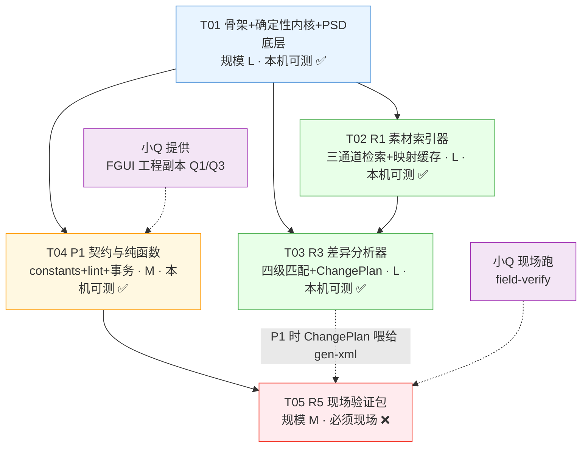

# 系统架构设计：FGUI 自动化拼 UI 工具链

| 项 | 内容 |
|---|---|
| 文档版本 | v1.0 |
| 日期 | 2026-05 |
| 作者 | 高见远（架构师） |
| 上游输入 | `docs/PRD.md` v1.0（许清楚） |
| 交付形态 | 本地 CLI（Node.js）+ 单文件 HTML 确认页 |
| 本轮范围 | **P0 = R1 素材索引器 + R2 PSD 解析器 + R3 差异分析器**；R4/R5 只留接口边界 |
| 决定性约束 | **开发者本机无 FairyGUI / Unity / C# 环境** → R1~R4 必须无编辑器可跑、可单测 |

---

## 0. 架构总览

### 0.1 一句话架构

> **一条纯离线的确定性流水线：切图 → SQLite 特征库 → PSD → Design IR → 两份 IR 差异 → ChangePlan JSON。**
> 全程零网络、零编辑器、零人工介入即可跑通并单测；人工只在两个「看图确认」点介入（contact sheet、ir_overlay）。

### 0.2 模块与数据流

```
                     ┌───────────────────────────────────────────────┐
  切图目录 ─────────►│ R1 素材索引器                                  │
  (无名 PNG/JPG)      │  ImageDecoder → FeatureExtractor → Grid9      │
                     │  → AssetStore(node:sqlite) + 本地特征表        │
                     │  产出: assets.db / contact_sheet.html / map.json│
                     └───────────────┬───────────────────────────────┘
                                     │ 三通道检索 Ch-1/Ch-2/Ch-3
                                     │ (仅在 R3 L3 兜底时被调用)
  PSD ×N ───────────►┌───────────────┴───────────────────────────────┐
  (状态A/状态B)       │ R2 PSD 解析器                                 │
                     │  CanvasShim → PsdReader → IrBuilder           │
                     │  产出: design_ir.{A,B}.json + ir_overlay.html  │
                     └───────────────┬───────────────────────────────┘
                                     │ 绝对 bbox + 归一名 + pHash
                                     ▼
                     ┌───────────────────────────────────────────────┐
                     │ R3 差异分析器                                  │
                     │  ChangeMatcher(L1→L4) → DiffClassifier        │
                     │  → StructureAdvisor → ChangePlanner           │
                     │  产出: change_plan.json ★人可读可改            │
                     └───────────────────────────────────────────────┘
                                     │
                    ─ ─ ─ ─ ─ ─ ─ ─ ─┴─ ─ ─ ─ ─ ─ ─ ─ ─ ─ ─ ─ ─   ← P0 到此为止
                                     │
                  ┌──────────────────┴──────────────────┐
                  ▼ P1                                ▼ P1
        ┌───────────────────┐              ┌────────────────────┐
        │ R4 XML+lint+事务写盘 │              │ R5 现场验证包         │
        │ (接口边界已留)       │              │ (接口边界已留)        │
        └───────────────────┘              └────────────────────┘
```

### 0.3 三条不可违背的架构红线

| # | 红线 | 落地方式 |
|---|---|---|
| 1 | **禁止网络** | 不引入任何 HTTP 客户端依赖（除 P1 桥客户端）；`src/core/net-guard.js` 在测试中拦截 `http/https/dns/net.connect` 并让测试失败（PRD K1） |
| 2 | **确定性输出** | 统一 `writeJson()`：固定 2 空格缩进、固定键序、固定 `\n`、无时间戳、路径一律 POSIX 相对化、数组显式稳定排序；`Date.now()` 只能出现在 `.bak.<ts>` 文件名与 `run_meta.json`（PRD B9） |
| 3 | **中间产物人可读** | `design_ir.json` / `change_plan.json` / `map.json` 全部带 `_comment` 字段说明每个字段含义，`evidence` 字段必须写「为什么这么判」（PRD A10） |

---

## 1. 实现方案与框架选型

### 1.1 核心技术难点与解法

| # | 难点 | 解法 | 依据 |
|---|---|---|---|
| D1 | **模块解析**：Node 的 `NODE_PATH` 对 ESM `import` 无效 | **全面使用 CommonJS**（`require`），不用 ESM | 实测：`NODE_PATH=... node -e "import('image-size')"` → `ERR_MODULE_NOT_FOUND`；`require('image-size')` → 正常 |
| D2 | **ag-psd 需要 canvas**：Node 无原生 canvas，直接解析会抛 `Canvas not initialized` | 自实现 `CanvasShim`：注入最小 2D context 垫片（只需 `createImageData`/`getImageData`/`putImageData`/`drawImage`），并强制 `useImageData:true` 让像素走 `imageData` 而非 `canvas` | 实测：不装 shim → `Error: Canvas not initialized`；装 shim → 图层与合成图 `imageData` 均正常导出 |
| D3 | **ag-psd 组图层 bbox 不可信**：合成测试中组自身 `left/top/right/bottom` 全为 0 | `IrBuilder.deriveGroupBox()`：**组 bbox 一律由子层 bbox 并集推导**，绝不读组自身坐标 | 实测：`outer` 自身 `=0,0,0,0`，子层并集 `=20,10,180,90` |
| D4 | **确定性输出**（B9） | 中心化 `writeJson()`：键序白名单 + 浮点定点化（`toFixed(6)`）+ 排序；时间戳只在 `run_meta.json` | PRD B9「逐字节一致」 |
| D5 | **K5 前缀包含陷阱**：`矩形1` 与 `矩形11` | `NameNormalizer` **只做全等匹配，禁止 `startsWith`/`includes`**；归一化后同名多图 → 尺寸校验二次判别，仍歧义则全部标 `AMBIGUOUS` 进确认队列 | PRD K5 |
| D6 | **SQLite 依赖**：`better-sqlite3` 需原生编译，Node 22/24 兼容性易踩坑 | 用**内置 `node:sqlite`**（`DatabaseSync`），零原生依赖；启动加 `--disable-warning=ExperimentalWarning` | 实测：Node 22.22.2 与 24.15.0 均内置可用 |
| D7 | **pHash 依赖**：`imagehash` 是 Python 库 | 自实现 `phash.js`（32×32 灰度 → 8×8 DCT → 中位数阈值 → 64bit），纯 JS 无依赖 | 实测：产出 16 位十六进制串，自汉明距离 = 0，跨次稳定 |
| D8 | **繁简归一化**：需 OpenCC 词典，Node 侧无轻量方案 | 本轮用**可配置映射表**（`src/core/variants.js`，默认内置常用字对照），词典缺失时降级为「不做繁简转换」并在 `evidence` 标注；词典作为 P1 交付物 | 避免为低频场景引入重型依赖 |

### 1.2 框架选型

| 层 | 选型 | 版本 | 理由 |
|---|---|---|---|
| 运行时 | Node.js | **≥ 22.5**（实测 22.22.2 / 24.15.0 均可） | 内置 `node:sqlite`；上游 bridge 同栈 |
| 模块系统 | **CommonJS** | — | D1：`NODE_PATH` 只对 CJS 生效，这是本机零安装跑起来的前提 |
| PSD 解析 | `ag-psd` | **31.0.3**（已装） | 同栈、纯 JS、依赖仅 `base64-js`+`pako`（均已装） |
| 图像解码/特征 | `sharp` | **0.34.4** | libvips 预编译包，**安装实测 18s 成功**；一次调用即可拿到 raw RGBA / greyscale / resize / stats.dominant，省掉手写 PNG 解码 |
| 尺寸快路径 | `image-size` | **2.0.4**（已装） | 只读 header，比 sharp 快，用于 Ch-1 的 ±2px 尺寸校验 |
| 索引 | `node:sqlite`（内置） | 随 runtime | D6 |
| 测试 | `node:test` + `node:assert/strict` | 内置 | 零依赖，P0 无需装任何东西 |
| **Python** | **不使用** | — | PRD 已定 Node 为主栈。Python venv 虽在装 pillow/imagehash/numpy，但引入跨语言进程调用会让 P0 闭环多一个失败点；sharp + 自实现 pHash 已覆盖全部特征需求 |

**为什么不用 Python 做特征提取**（团队 lead 要求论证）：
`imagehash` 的 pHash 与我们要的 64bit DCT pHash 算法一致，看似省事。但：① 需要维护 Python venv 与 Node 两套依赖；② 217 张图的特征提取是 <2s 量级，性能完全不是瓶颈；③ 跨语言调用在 Windows 上路径/编码问题多；④ PSD 解析（ag-psd）在 Node，Python 无法共享解析结果。**结论：全 Node，Python 不进主链路。**

**sharp 依赖风险与降级**：`sharp` 是唯一需要联网安装的包（其余均为内置或已装）。为防公司机器装不上，`src/imaging/decoder.js` 定义 `ImageDecoder` 接口，P0 阶段提供两个实现：`sharp` 实现（默认）与 `pngjs` 实现（仅支持 PNG，用于降级冒烟）。**不因为降级实现而拖慢主链路开发**。

---

## 2. 文件列表

### 2.1 目录树

```
D:\UItool\
├─ package.json                       # 统一 type:commonjs / bin / scripts
├─ .gitignore                         # 排除素材目录与产物（PRD K1 第④条）
├─ README.md                          # 快速上手 + 离线声明
├─ fgui.config.json                   # 默认配置（阈值、扩展名、路径）
│
├─ bin\
│  └─ fgui-rb.js                      # CLI 入口（shebang），子命令分发
│
├─ src\
│  ├─ cli\
│  │  ├─ index.js                     # 命令注册表 + 参数解析
│  │  ├─ cmd-asset-index.js           # R1-F1 建索引
│  │  ├─ cmd-asset-search.js          # R1-F5 检索 + 人工确认写 map.json
│  │  ├─ cmd-psd-ir.js                # R2-F4 解析
│  │  ├─ cmd-diff-plan.js             # R3 差异分析
│  │  ├─ cmd-selftest.js              # 一键自检（黄金样本 e2e）
│  │  └─ cmd-gen-xml.js               # P1 桩：仅打印「未实现 + 需 FGUI 工程」
│  │
│  ├─ core\
│  │  ├─ logger.js                    # 结构化日志（§8.2 格式）
│  │  ├─ errors.js                    # 错误码 + 退出码映射（§8.1）
│  │  ├─ config.js                    # 配置加载与默认
│  │  ├─ fs-json.js                   # writeJson/readJson，确定性序列化核心
│  │  ├─ atomic.js                    # 原子写 + .bak 备份（§4.3）
│  │  ├─ normalize.js                 # 名称归一化 + variants 繁简表
│  │  ├─ hash.js                      # sha256 / hamming64
│  │  ├─ determinism.js               # 稳定排序 + 浮点定点化
│  │  ├─ net-guard.js                 # 禁网守卫（测试期生效）
│  │  └─ variants.js                  # 繁简/异体字映射表（可扩展）
│  │
│  ├─ imaging\
│  │  ├─ decoder.js                   # ImageDecoder 接口 + sharp 实现
│  │  ├─ features.js                  # R1-F2 alpha 包围盒/透明比/主色/边缘密度
│  │  ├─ phash.js                     # 64bit DCT pHash
│  │  └─ grid9.js                     # R1-F3 九宫格适用性启发式
│  │
│  ├─ assets\
│  │  ├─ store.js                     # AssetStore（node:sqlite DDL + 查询）
│  │  ├─ indexer.js                   # 递归扫描 + 增量 + 特征抽取编排
│  │  ├─ search.js                    # 三通道检索 + 加权评分
│  │  ├─ channel1-name.js             # Ch-1 精确同名 + ±2px 尺寸校验
│  │  ├─ channel2-shape.js            # Ch-2 尺寸 + alpha 包围盒 IoU
│  │  ├─ channel3-phash.js            # Ch-3 pHash + 主色直方图
│  │  ├─ map-cache.js                 # R1-F6 映射缓存（零重算）
│  │  ├─ suggest-name.js              # R1-F7 建议名（只建议不重命名）
│  │  └─ contact-sheet.js             # R1-F4 单文件 HTML + data: URI
│  │
│  ├─ psd\
│  │  ├─ canvas-shim.js               # ★ 免原生 canvas 垫片（D2）
│  │  ├─ reader.js                    # ag-psd 封装（结构 + 合成图两档）
│  │  ├─ ir-builder.js                # 图层树 → DesignIr，组 bbox 并集（D3）
│  │  ├─ merged-detect.js             # R2-F5 合并图层标记 + lost_info 告警
│  │  ├─ text-extract.js              # R2-F2 文本图层
│  │  └─ slice-extract.js             # R2-F3 导出切片（若 PSD 有）
│  │
│  ├─ diff\
│  │  ├─ matcher.js                   # L1→L4 四级匹配
│  │  ├─ classifier.js                # 七类差异判定 + summary
│  │  ├─ structure-advisor.js         # 重复结构/GList/复用件/双态建议
│  │  └─ planner.js                   # 组装 ChangePlan + open_questions
│  │
│  ├─ report\
│  │  ├─ ir-overlay.js                # R2-F6 SVG bbox 叠加效果图
│  │  └─ html-shell.js                # 单文件 HTML 模板（零构建）
│  │
│  └─ fgui\                            # ★ P1 接口边界（P0 只放类型与纯函数）
│     ├─ constants.js                 # 10 合法标签 / 8 extention / id 前缀 / 包 id 位数
│     ├─ lint-rules.js                # 纯函数 lint（P0 可单测，不碰文件系统）
│     ├─ xml-writer.js                # [P1] 组件 XML 生成
│     ├─ transaction.js               # [P1] 事务化写盘 + rollback
│     └─ bridge-client.js             # [P1] HTTP 到桥；probe 诚实上报
│
├─ test\
│  ├─ fixtures\
│  │  ├─ make-psd.js                  # ★ 用 ag-psd 造黄金样本 PSD（开发者无真实 PSD 也能测）
│  │  ├─ make-assets.js               # ★ 造合成切图（矩形/胶囊/圆形/放射）
│  │  └─ golden/                      # 生成的黄金样本（git 忽略）
│  ├─ unit\
│  │  ├─ normalize.test.js            # 含 K5 陷阱：矩形1 vs 矩形11
│  │  ├─ phash.test.js
│  │  ├─ grid9.test.js
│  │  ├─ features.test.js
│  │  ├─ determinism.test.js          # B9
│  │  ├─ net-guard.test.js            # K1：禁网守卫自证
│  │  ├─ search.test.js               # A1/A2/A3
│  │  ├─ map-cache.test.js            # A4 零重算
│  │  ├─ ir-builder.test.js           # A5/A6 + 组 bbox 并集
│  │  ├─ matcher.test.js
│  │  └─ lint-rules.test.js           # P1 纯函数，P0 就能测
│  └─ e2e\
│     └─ p0-pipeline.test.js          # 切图+PSD → change_plan.json 全链路
│
└─ docs\
   ├─ PRD.md
   ├─ ARCHITECTURE.md                 # 本文件
   ├─ class-diagram.mermaid
   └─ sequence-diagram.mermaid
```

### 2.2 文件职责速查（20 个关键文件）

| 文件 | 一句话职责 | 归 R |
|---|---|---|
| `src/psd/canvas-shim.js` | 让 ag-psd 在无原生 canvas 的 Node 里跑起来 | R2 |
| `src/psd/ir-builder.js` | 图层树扁平化 + 组 bbox 由子层并集推导 | R2 |
| `src/psd/merged-detect.js` | 标记被画师合并的组，进确认队列 | R2 |
| `src/core/normalize.js` | 名称归一化，**只允许全等匹配**（K5 防御） | R1 |
| `src/imaging/grid9.js` | 三档九宫格适用性启发式 | R1 |
| `src/assets/channel1-name.js` | Ch-1 精确同名 + ±2px 尺寸校验 | R1 |
| `src/assets/search.js` | `0.5·Ch1 + 0.3·Ch2 + 0.2·Ch3`，Ch-1 短路置顶 | R1 |
| `src/assets/map-cache.js` | 人工确认缓存，二次运行零重算 | R1 |
| `src/diff/matcher.js` | L1→L4；L4 一律 `INFERRED` + `default=skip` | R3 |
| `src/diff/classifier.js` | 七类差异 + 置信度 | R3 |
| `src/core/fs-json.js` | 确定性 JSON 写出（B9 地基） | 跨 |
| `src/core/atomic.js` | 原子替换 + `.bak.<ts>` + 回滚 | P1 |
| `src/fgui/lint-rules.js` | 纯函数 lint，P0 即可单测 | P1 |
| `src/fgui/constants.js` | 10 标签 / 8 extention / 8 位包 id | P1 |
| `test/fixtures/make-psd.js` | 造黄金 PSD，破解「本机无真实素材」 | 跨 |

---

## 3. 数据结构与接口

### 3.1 完整类图

见 `docs/class-diagram.mermaid`（Mermaid `classDiagram`）。核心类职责：

| 类 | 层 | 关键约束 |
|---|---|---|
| `NameNormalizer` | core | `normalize()` 纯函数；**禁止前缀/子串匹配** |
| `FeatureExtractor` | imaging | 输出 `AssetFeatures`，全部字段确定性 |
| `Grid9`（判定） | imaging | 三档 + `confidence` + `evidence[]`（人可推翻） |
| `AssetStore` | assets | `node:sqlite`；`byNormName()` **可能返回多行**（K5 歧义） |
| `AssetSearch` | assets | 三通道独立可测，`score()` 权重固定常量 |
| `MapCache` | assets | 指纹失效检测，命中即零重算 |
| `IrBuilder` | psd | 组 bbox **必须**由子层并集推导 |
| `ChangeMatcher` | diff | L1/L2/L3/L4 逐级；L4 强制 `INFERRED` |
| `DiffClassifier` | diff | 输出必带 `evidence` 字符串 |
| `StructureAdvisor` | diff | 只**建议**，不写死策略 |
| `LintRules` | fgui | **纯函数**：入参为 XML 字符串，不碰文件系统 |

### 3.2 关键接口签名

```js
// ---- 归一化（R1 地基） ----
// opts.stripCopySuffix: 去 (1)/(2) 副本后缀，默认 true
// opts.variants: 繁简映射表，默认内置常用字
function normalizeName(raw, opts) -> string

// ---- 特征提取 ----
function extractFeatures(rawImage) -> AssetFeatures
// { w,h,alphaRatio,alphaBox{x,y,w,h},phash(16 hex),
//   dominantR/G/B,edgeDensity,cornerSolidity,
//   midRowVariance,midColVariance,radialSymmetry,aspectRatio }

// ---- 九宫格适用性（R1-F3 / STANDARDS §2.7） ----
function computeGrid9(features) -> Grid9Verdict
// { verdict:'CAN_9GRID'|'SINGLE_AXIS_ONLY'|'NEVER',
//   confidence:0..1, evidence:[...], suggestedGrid:'r,0,w-2r,h'|null }
// 只做启发式，不做精确几何判定。判定不确定时返回 NEVER + 低 confidence，
// 交人工裁决 —— 宁可少建议，不可给错建议。

// ---- 三通道检索（R1-F5） ----
function searchAssets(query) -> SearchHit[]
// query: { index, queryName, layerBox:{w,h}|null, wantSize:{w,h}|null, topK }
// 排序：Ch-1 命中短路置顶；其余按 0.5·ch1+0.3·ch2+0.2·ch3 降序
// 同分时按 assetId 字典序 —— 保证确定性

// ---- 差异分析（R3） ----
function matchLayers(baseLayers, targetLayers) -> MatchPair[]
function classifyDiffs(pairs, ctx) -> { diffs:PlanDiff[], summary:object }

// ---- 纯函数 lint（P1，但 P0 可测） ----
function lintComponentXml(xml, opts) -> LintProblem[]
// opts: { pkgIdLength:8, maxObjects:80 }
// 返回 error/warn/info 三级；error 非空即阻断写盘

// ---- 事务化写盘（P1） ----
class FsTransaction {
  constructor({ targetPath, content, validator, now })
  commit()   -> { applied:bool, backupPath, problems[] }
  rollback() -> { restored:bool, backupPath }
}
```

### 3.3 Design IR Schema（在 PRD 草案基础上收敛）

```jsonc
{
  "version": "1.0",
  "_comment": "由 fgui-rb psd-ir 生成。bbox 为绝对坐标，单位 px。merged=true 表示画师已合并该组，子层信息不可恢复。",
  "source": {
    "psdPath": "state_A.psd",           // POSIX 相对化，保证确定性
    "psdSha256": "…",                   // 输入指纹，用于增量与复现
    "canvas": { "w": 1280, "h": 720 },
    "dpr": 1
  },
  "layers": [
    {
      "id": "L012",                      // 按 PSD 文档序递增，稳定
      "name": "矩形11",                   // 画师原名，不改
      "normName": "矩形11",               // 归一化名，供检索
      "parent": "L008",                  // null = 根
      "type": "raster",                   // raster|text|group|smartobject|slice
      "bbox": { "x": 120, "y": 88, "w": 720, "h": 420 },
      "bboxSource": "own",               // own=图层自身 | derived=子层并集（D3）
      "rotation": 0,
      "opacity": 1,                      // 0..1，定点化输出
      "visible": true,
      "blend": "normal",
      "merged": false,
      "childCount": 0,
      "slice": { "name": "mail_bg", "rect": [120, 88, 720, 420] },
      "text": null
    }
  ],
  "warnings": [
    { "code": "MERGED_LAYER_GROUP", "layer": "L030",
      "msg": "组『组1200拷贝』被合并，展开为 3 层扁平内容" }
  ],
  "sliceNames": ["mail_bg", "btn_close"],
  "_bboxNote": "组图层的 bbox 由其子层并集推导；ag-psd 返回的组自身坐标在实测中为 0，不可直接采信。"
}
```

### 3.4 ChangePlan Schema（在 PRD 草案基础上收敛）

```jsonc
{
  "version": "1.0",
  "_comment": "由 fgui-rb diff-plan 生成。可手工编辑后续跑 gen-xml。INFERRED 项未确认前不会写入 XML。",
  "task": { "name": "MailDetail", "basePkg": "Mail", "targetPkg": "Mail" },
  "sources": { "psdBase": "state_A.psd", "psdTarget": "state_B.psd", "fguiProject": null },
  "summary": { "reuse": 4, "move": 3, "resize": 1, "restyle": 2,
               "add": 6, "remove": 1, "inferred": 2, "total": 19 },
  "diffs": [
    {
      "op": "REUSE", "slot": "popup_bg", "node": "L012",
      "matchLevel": "L1", "confidence": 1.0,
      "evidence": "slice 'mail_bg' 一致，且 alpha 包围盒尺寸 720x420 与切图 mail_bg.png 完全吻合",
      "fguiStrategy": { "type": "reuse", "detail": { "refName": "PanelFrame" } }
    },
    {
      "op": "ADD", "slot": "reward_list", "node": "L041",
      "matchLevel": "L4", "confidence": 0.2,
      "evidence": "L1/L2/L3 均未命中，判定为新增",
      "fguiStrategy": { "type": "list", "detail": {
        "layout": "flow_hz", "defaultItem": "MailItemCell",
        "itemCount": 3, "itemSize": [96, 96], "gap": 12 } }
    },
    {
      "op": "INFERRED", "slot": "icon_3", "node": "L048",
      "matchLevel": "L4", "confidence": 0.15,
      "evidence": "父组 merged=true，子层信息不可恢复；候选 pHash 距离分别为 7 与 19",
      "candidates": ["图层249(1).png", "矩形11.png"],
      "defaultIfUnconfirmed": "skip",
      "_attention": "低置信度一律 skip 而非猜测（PRD K4 第②条）"
    }
  ],
  "structureAdvice": [
    { "type": "list", "slot": "reward_list", "reason": "同父级下 3 个 96x96 等距节点",
      "suggestion": { "extention": "List", "layout": "flow_hz" } }
  ],
  "openQuestions": [
    "状态B 的奖励物品是否为 3 列 flow_hz？",
    "领取按钮灰置条件由代码控制还是图控？"
  ]
}
```

### 3.5 assets.db 表结构

```sql
CREATE TABLE asset (
  id            TEXT PRIMARY KEY,   -- sha1(relPath) 前 16 位，稳定
  rel_path      TEXT NOT NULL UNIQUE,-- POSIX 相对路径
  base_name     TEXT NOT NULL,
  norm_name     TEXT NOT NULL,      -- 归一名，检索主键
  format        TEXT NOT NULL,
  w INTEGER, h INTEGER,
  file_size     INTEGER,
  mtime_ms      INTEGER,            -- 增量扫描用
  content_sha256 TEXT NOT NULL,     -- 特征指纹
  -- 特征（可为空：--no-features 时仅建索引）
  alpha_ratio REAL, alpha_x INTEGER, alpha_y INTEGER,
  alpha_w INTEGER, alpha_h INTEGER,
  phash TEXT,                        -- 16 位 hex
  dominant_r INTEGER, dominant_g INTEGER, dominant_b INTEGER,
  edge_density REAL, corner_solidity REAL,
  mid_row_variance REAL, mid_col_variance REAL,
  radial_symmetry REAL,
  grid9_verdict TEXT, grid9_confidence REAL, grid9_evidence TEXT,
  suggested_name TEXT,
  -- 生命周期
  first_seen_run TEXT, last_seen_run TEXT
);
CREATE INDEX idx_norm  ON asset(norm_name);
CREATE INDEX idx_size  ON asset(w, h);
CREATE INDEX idx_phash ON asset(phash);
CREATE INDEX idx_run   ON asset(last_seen_run);

CREATE TABLE meta (k TEXT PRIMARY KEY, v TEXT);      -- schema_version / last_run
CREATE TABLE slot_map (                              -- R1-F6 映射缓存（镜像 map.json，便于单查）
  slot TEXT PRIMARY KEY, asset_id TEXT NOT NULL,
  fingerprint TEXT NOT NULL, confirmed_by TEXT, confirmed_at TEXT
);
```

**为什么 `byNormName` 可能返回多行**：K5 的 `矩形1` / `矩形11` 陷阱，以及同名不同尺寸的切图都存在。`AssetStore.byNormName()` 返回数组是**刻意的 API 设计**，强制调用方处理歧义。

---

## 4. 程序调用流程

完整时序图见 `docs/sequence-diagram.mermaid`（4 个场景）。此处说明关键设计点。

### 4.1 主闭环（P0）

```
asset-index → psd-ir ×2 → diff-plan
```

### 4.2 Ch-1 精确同名通道（R1 地基，A2 覆盖率的生命线）

```
query.layerBox = {w,h}
  ↓
byNormName(normalizeName(query.queryName))
  ↓
候选集为空 ───────────────→ 落 Ch-2
  ↓ 非空
逐候选做 ±2px 尺寸校验：|bbox.w - img.w| <= 2 && |bbox.h - img.h| <= 2
  ↓
通过者 = 1  → Ch1=1.0 命中，短路置顶，返回 confidence=1.0
通过者 >1  → 全部返回，但 confidence <= 0.6 且 evidence 标注 AMBIGUOUS，进确认队列
通过者 = 0  → 落 Ch-2
```

**K5 防御是双保险**：
1. 归一化阶段只允许**全等**匹配（`normalizeName(a) === normalizeName(b)`），**严禁** `a.startsWith(b)` 或 `includes`。`矩形1` 归一化后是 `矩形1`，`矩形11` 是 `矩形11`，二者不相等 → 不会被前缀包含误匹配。
2. 即便归一化后真的同名（如 `矩形1` 与 `矩形1(1)` 去副本后缀后同名），尺寸校验会二次判别；仍歧义则 `AMBIGUOUS` 进队列而非静默取第一个。

### 4.3 事务化写盘（P1，路线 C 落地）

```
① 生成候选内容到内存
② lintComponentXml(候选内容)  ── 有 error ─→ 退出码 3，不动磁盘
③ 写 <target>.tmp
④ 复检 tmp 内容（防写入截断/编码损坏）  ── 有 error ─→ 删除 tmp，退出码 3
⑤ 目标已存在 ─→ 复制 <target> → <target>.bak.<ts>
⑥ fs.rename(tmp, target)   —— 原子替换
⑦ 任一步失败 ─→ 用 .bak 恢复原文件，返回 { applied:false }，退出码 5
⑧ 成功 ─→ 返回 { applied:true, backupPath } + reload_hint
```

**写盘序列（P1，PRD R4-F5）**：
`关编辑器` → 写盘 → `重启编辑器` → `refresh` → `read_component` 抽查 3 点 → `lint`（0 error）→ `publish` → `check_publish` 对账。

**`<ts>` 的可测性**：`.bak` 文件名里的时间戳会让「同一输入跑两次 → 目录树不同」，破坏 B9 的逐字节比较。因此：`now` 由参数注入（`--now <iso>`），默认用 `Date.now()`；测试与 B9 验证统一传固定 `--now`。B9 的比较范围**只含生成物**（XML/JSON/HTML），不含 `.bak`。

### 4.4 确定性输出的具体做法（B9）

| 污染源 | 处理 |
|---|---|
| 对象键序 | `writeJson()` 按**键名字母序**序列化（不依赖插入序） |
| 浮点 | 全部 `round6()`：`Number(v.toFixed(6))`，消除平台差异 |
| 数组顺序 | 所有输出数组**显式排序**：layers 按 id、diffs 按 `(op, slot)`、warnings 按 `(code, layer)` |
| 时间戳 | 产物内**零时间戳**；仅 `run_meta.json` 记录，与产物分离 |
| 绝对路径 | 一律 POSIX 相对化（`path.relative` + `replace(/\\/g,'/')`） |
| 随机数 | 全部不使用；`Math.random()` 在 `net-guard.test.js` 中被断言为零引用 |
| Map/Set 迭代 | 禁止直接遍历输出，一律 `[...map.entries()].sort(byKey)` |
| 换行/编码 | `\n` + UTF-8 无 BOM + 2 空格缩进 + 末尾恰好一个 `\n` |

### 4.5 九宫格适用性启发式（R1-F3 / STANDARDS §2.7）

**明确不做精确几何判定。** 只用 6 个已算好的特征做加权判定：

| 判定档 | 触发条件（启发式） | 建议 |
|---|---|---|
| `NEVER` | `radialSymmetry > 0.6`（放射/对角纹理）**或** `aspectRatio ∈ [0.9,1.11] && cornerSolidity < 0.5 && edgeDensity > 0.35`（圆形） | 不建议切九宫格 |
| `SINGLE_AXIS_ONLY` | `aspectRatio >= 2.0 && aspectRatio <= 4.5 && cornerSolidity < 0.85 && midRowVariance < 0.05 && midColVariance > 0.08`（胶囊/全圆头） | `scale9grid="r,0,w-2r,h"` |
| `CAN_9GRID` | 四角实心（`cornerSolidity >= 0.85`）且中行中列方差低（拉伸不变形） | 常规九宫格 |
| `UNKNOWN → NEVER` | 任一特征缺失或落在阈值间空白区 | 返 `NEVER` + `confidence <= 0.4` + `evidence` 说明「不确定，建议人工确认」 |

**取值哲学**：不确定时返 `NEVER` 而非 `CAN_9GRID`。理由：`NEVER` 的后果是「人工手动切一次」，成本 10 秒；误判 `CAN_9GRID` 的后果是「线上按钮圆头被拉成椭圆」，成本是事故。这与 PRD「在生成阶段就阻止事故」的定位一致。

阈值全部外置到 `fgui.config.json`，引擎师可用真实素材回归后调整。

### 4.6 合并图层标记（R2-F5 / K4）

```
对每个 group 图层 G：
  if G.childCount > 0 且 G.subtree 中所有子层均为 raster 且无一携带 slice：
      G.merged = true
      warnings.push({ code:'MERGED_LAYER_GROUP', layer:G.id, msg:'…' })
```

`merged=true` 的图层在 R3 中：
- 允许 L3（pHash）尝试匹配，但 `confidence` 强制封顶 `0.5`
- 匹配失败一律 `L4 → INFERRED`，`defaultIfUnconfirmed = 'skip'`
- **不进人工确认队列的自动写入路径**

### 4.7 单文件 HTML 产物（零构建）

`contact_sheet.html` 与 `ir_overlay.html` 共用 `html-shell.js`：

| 产物 | 构造方式 | 体积控制 |
|---|---|---|
| contact sheet | 缩略图 `sharp.resize(96,96).png()` → base64 `data:` URI，按 `normName` 排序后内联 | 217 张 ≈ 3~5MB；超 `--max-inline` 时降级为「写 `contact-sheet.json` + 提示走文件引用」 |
| ir overlay | 合成图 base64 + SVG `<rect>` 叠加 bbox，hover 显示图层名 | 合成图 1280×720 PNG ≈ 1~2MB，可接受 |

零外部 JS 库、零 CDN、零网络请求（K1 强制）。筛选用**原生 `<input>` + 内联 20 行原生 JS**。

---

## 5. 关键技术决策与取舍

| # | 决策 | 取舍理由 | 放弃的方案 |
|---|---|---|---|
| 1 | **CommonJS 而非 ESM** | `NODE_PATH` 对 ESM 无效（实测），CommonJS 才能零安装跑 | ESM（需在项目内 `npm i` 复现依赖） |
| 2 | **`node:sqlite` 而非 `better-sqlite3`** | 零原生编译、零版本兼容坑 | better-sqlite3（需 prebuild/N-API 编译） |
| 3 | **sharp 而非纯 JS 图像库** | libvips 预编译，实测安装 18s；一次调用拿 raw+stats | `pngjs`+`jpe-js`（功能齐但要自己实现缩放/统计，工作量大 3~5 倍） |
| 4 | **自实现 pHash 而非 `imagehash`** | Python 跨语言不值得 | Python sidecar 进程 |
| 5 | **组 bbox 由子层并集推导** | 实测组自身坐标为 0，直接采信必错 | 直接读 ag-psd 的组坐标 |
| 6 | **CanvasShim 垫片而非装 `canvas` 原生包** | 免原生编译；ag-psd 只需要 ImageData 容器，不需要真实渲染 | `canvas` / `skia-canvas` |
| 7 | **Ch-1 只允许全等匹配** | K5 明确警告前缀包含陷阱；全等零歧义 | `startsWith` 前缀匹配（小 Q 现有做法，PRD 已判定失败） |
| 8 | **九宫格不确定 → NEVER** | 误判成本不对称 | 不确定 → CAN_9GRID（乐观） |
| 9 | **INFERRED 默认 skip 而非猜测** | PRD K4 第②条：宁可少做一个节点让人补，不要错一个 | INFERRED 默认按新增写入 |
| 10 | **中间产物全 JSON + `_comment`** | 客户命名混乱、需求含糊，每步都要人可干预 | 二进制中间格式 |
| 11 | **lint 用纯函数** | 不碰文件系统 ⇒ P0 阶段就能单测，P1 不用返工 | 直接读目录做 lint（P0 无法测试） |
| 12 | **R4/R5 只留接口不实现** | 无 FGUI 环境写不了也测不了；先把边界和常量定死，M4 能直接开工 | 本轮硬写 XML 生成（写了也验证不了） |
| 13 | **`now` 注入以便 B9 验证** | `.bak` 文件名含时间戳会污染确定性比较 | 忽略 `.bak`（更脆弱，忘了忽略就误判） |

### 5.1 PRD §5.3 踩坑清单 → 代码硬约束

| 上游坑 | 落地位置 | 形式 |
|---|---|---|
| `#RRGGBBAA` 只取后 6 位 → 纯蓝 | `fgui/constants.js` + `lint-rules.js` | `checkColor()` 对 8 位色直接报 **error** 阻断写盘 |
| `OpenDocument` 不可用 | 产品主链路**零依赖** | P1 `bridge-client.probe()` 诚实上报可用性，但**不作为主链路前置** |
| `screenshot` 被裁（truthy 但不可调用） | 同上 | **禁止真值守卫，必须 try/catch 实调**（上游明确要求） |
| 免费版 `batchmode` 被拦 | 不使用 | 全链路无 batchmode |
| 编辑器最小化暂停主循环 | R5 Runbook | 提醒「不要关闭编辑器」（探测阶段）；写盘阶段相反，要求关闭 |
| `path`/`extentionId` 未用时传 `null` 而非 `""` | P1 `xml-writer.js` | 常量 + 注释标注 |
| `package.xml` 被内存态覆盖 | R4-F5/F6 | 默认**禁止**改 `package.xml`；写盘必须先关编辑器 |
| `read_component` 成功 ≠ 编辑器能打开 | R5 Runbook | 强制完整序列：lint → 重启 → refresh → 抽查 → publish → 对账 |
| 6 位包 id 吃 itemId 首字符 | `fgui/constants.js` | `pkgIdLength: 8` 断言 |
| `extention` 拼写 | `fgui/constants.js` | 常量名与字符串均为 `extention`（不加 `s`），代码注释警示 |

### 5.2 九宫格判定规则（STANDARDS §2.7）落地

`grid9.js` 的三条规则直接对应 STANDARDS：

1. **胶囊/全圆头** → `SINGLE_AXIS_ONLY`，输出 `scale9grid="r,0,w-2r,h"`：中心区纵向占满，圆头整个落边栏。
2. **圆形/放射/对角高光纹理** → `NEVER`：这类图九宫格拉伸必然破形。
3. **四角实心 + 中心区平坦** → `CAN_9GRID`。

> 「圆头整个落边栏」的实现约定：常规九宫格是 `l,t,w,h` 四边留角；胶囊是**上/下不留角**（垂直方向不切），即 `l=r, t=0, w=imgW-2r, h=imgH`。输出字符串为 `r,0,w-2r,h`（首值=左=右=r，次值上=0，第三值中心宽，第四值中心高=全高）。**此格式待小 Q 用真实胶囊素材确认（Q 新增 Q17）。**

---

## 6. 任务列表

> 依赖顺序执行。P0 任务（T01~T04）**本机 100% 可完成并自测**，不依赖任何公司素材。
> T05（P1）可完成**契约与纯函数部分**，依赖小 Q 提供 FGUI 工程副本。

### T01 · 项目骨架 + 确定性内核 + 图片/PSD 底层能力

| 项 | 内容 |
|---|---|
| **产出文件** | `package.json`、`.gitignore`、`README.md`、`fgui.config.json`、`bin/fgui-rb.js`、`src/cli/index.js`、`src/cli/cmd-*.js`（5 个子命令骨架）、`src/core/{logger,errors,config,fs-json,determinism,hash,net-guard}.js`、`src/imaging/{decoder,features,phash,grid9}.js`、`src/psd/{canvas-shim,reader,ir-builder,merged-detect,text-extract,slice-extract}.js`、`src/report/{html-shell,ir-overlay}.js`、`test/fixtures/{make-psd,make-assets}.js`、`test/unit/{phash,grid9,features,determinism,net-guard,ir-builder}.test.js` |
| **依赖** | 无 |
| **规模** | **L** |
| **验收标准** | ① `node bin/fgui-rb.js selftest` 一键跑通；② `make-psd.js` 生成的合成 PSD 能被 `ir-builder` 正确解析，**组 bbox = 子层并集**（断言 `outer` 得 `20,10,180,90` 而非 `0,0,0,0`）；③ 同一输入连续跑 3 次 `design_ir.json` **逐字节一致**；④ `net-guard.test.js` 断言 `src/` 中零 `http`/`https` 出站引用；⑤ 20 张合成切图（矩形/胶囊/圆形/放射各 5 张）的九宫格判定与人工预期一致 |
| **本机可自测** | ✅ 完全可 |

### T02 · R1 素材索引器：归一化 + 三通道检索 + 映射缓存

| 项 | 内容 |
|---|---|
| **产出文件** | `src/core/normalize.js`、`src/core/variants.js`、`src/assets/{store,indexer,search,channel1-name,channel2-shape,channel3-phash,map-cache,suggest-name,contact-sheet}.js`、`src/cli/cmd-asset-index.js`、`src/cli/cmd-asset-search.js`、`test/unit/{normalize,search,map-cache}.test.js` |
| **依赖** | T01 |
| **规模** | **L** |
| **验收标准** | ① **K5 陷阱单测**：`矩形1.png` 与 `矩形11.png` 共存时，`矩形11` 检索**不得**返回 `矩形1`；② Ch-1 覆盖率达 50%（合成集断言，A2）；③ Top-10 查询 < 200ms @ 1000 张（基准脚本，A3）；④ 人工确认后再跑，100% 命中缓存且零特征重算（A4）；⑤ `contact_sheet.html` 单文件可离线打开，缩略图全部内嵌 |
| **本机可自测** | ✅ 完全可 |

### T03 · R3 差异分析器：四级匹配 + 七类差异 + ChangePlan

| 项 | 内容 |
|---|---|
| **产出文件** | `src/diff/{matcher,classifier,structure-advisor,planner}.js`、`src/cli/cmd-diff-plan.js`、`test/unit/{matcher,classifier}.test.js`、`test/e2e/p0-pipeline.test.js` |
| **依赖** | T01（IR）、T02（检索 L3 兜底） |
| **规模** | **L** |
| **验收标准** | ① L1 slice 命中、L2 归一名命中、L3 pHash 兜底、L4 `INFERRED` 四条路径各有单测；② `merged=true` 的组内节点匹配 `confidence` 封顶 0.5；③ 未能匹配的节点 100% 标 `INFERRED` 且 `defaultIfUnconfirmed='skip'`；④ 合成「邮件弹窗 A/B 两态」端到端产出 `change_plan.json`，同一输入跑 3 次逐字节一致；⑤ `INFERRED` 数量 ≤ 3（A8）；⑥ 每条 diff 都有可读的 `evidence` 字符串 |
| **本机可自测** | ✅ 完全可（用 `make-psd.js` 合成的两态 PSD） |

### T04 · P1 契约与纯函数（FGUI 规范层）

| 项 | 内容 |
|---|---|
| **产出文件** | `src/fgui/constants.js`、`src/fgui/lint-rules.js`、`src/fgui/transaction.js`、`src/fgui/xml-writer.js`（核心骨架）、`src/fgui/bridge-client.js`（`probe()` 骨架）、`src/core/atomic.js`、`test/unit/lint-rules.test.js` |
| **依赖** | T01 |
| **规模** | **M** |
| **验收标准** | ① `lintComponentXml()` 为**纯函数**，P0 阶段可完整单测；② 8 位色（`#RRGGBBAA`）被判 **error**；③ 非法 `displayList` 标签（超出 10 种）与非法 `extention`（超出 8 种）被判 error；④ 九宫格越界判 error；⑤ `exported` 漏失判 error；⑥ `FsTransaction` 单测：注入一次 validator 失败，断言原文件 md5 未变且 `.bak` 已生成（B7）；⑦ 同一 content 两次 commit 产出的文件逐字节一致 |
| **本机可自测** | ✅ 纯函数与事务层完全可测；❌ 真实 FGUI 工程对账需小 Q 提供脱敏副本（Q3） |

### T05 · P1 现场验证包（R5）

| 项 | 内容 |
|---|---|
| **产出文件** | `field-verify/field-verify.ps1`、`field-verify/RUNBOOK.md`、`field-verify/probe-bridge.ps1`、`src/cli/cmd-gen-xml.js`（接通 T04）、`src/cli/cmd-rollback.js` |
| **依赖** | T04 + 小 Q 提供 FGUI 工程副本（Q3/Q1） |
| **规模** | **M** |
| **验收标准** | ① `field-verify.ps1` 一条命令跑完 PRD §3 R5 标准序列 10 步，每步输出结构化 JSON；② 桥能力探测**如实报告** `ping`/`project_info`/`list_packages` 可用性 + 编辑器版本；`OpenDocument`/`screenshot` 用 **try/catch 实调**（禁止真值守卫）；③ 截屏用 PowerShell `CopyFromScreen`，**不使用** `screenshot`；④ Runbook 含常见报错对照表；⑤ 全部产物落 `verify-out/` |
| **本机可自测** | ❌ **必须现场**（小 Q 公司机器） |

### 6.1 任务依赖图



### 6.2 本轮可完成 vs 需等待（明确边界）

**工程师本轮就能完成并自测（不依赖公司任何素材）**：

| 任务 | 自测手段 |
|---|---|
| T01 全部 | `test/fixtures/make-psd.js` 用 ag-psd `writePsd()` 造合成 PSD；`make-assets.js` 用 sharp 造合成切图。全部单测在本机跑 |
| T02 全部 | 用合成切图集（217 张量级可生成）跑 A1/A2/A3/A4；K5 陷阱单测 |
| T03 全部 | 用合成的「邮件弹窗 A/B 两态」跑完整闭环，产出 `change_plan.json` |
| T04 全部 | `lint-rules.js` 与 `transaction.js` 都是纯函数/纯本地文件操作，用自造 XML + 临时目录测试 |

**必须等公司素材/环境才能验收**：

| 项 | 缺什么 | 谁提供 |
|---|---|---|
| A5（PSD 解析 100% 正确） | 邮件弹窗两份真实 PSD | 小 Q（M2 依赖） |
| A7（差异分类一致率 ≥90%） | 小 Q 的人工标注对照表 | 小 Q（M3 依赖） |
| A10（小 Q 能读懂 JSON） | 真人试读 | 小 Q |
| B1~B9 全部 P1 指标 | FGUI 工程副本 + 现场执行 | 小 Q（M4/M5 依赖） |
| T05 全部 | 公司机器 + FairyGUI 编辑器 | 小 Q |
| 九宫格阈值标定 | 真实九宫格/胶囊/圆形素材 | 小 Q |

---

## 7. 依赖包清单

```jsonc
// package.json —— 运行时依赖刻意极少
{
  "name": "fgui-rb",
  "version": "0.1.0",
  "private": true,
  "type": "commonjs",                 // ← 必须，D1
  "engines": { "node": ">=22.5" },     // ← node:sqlite 需要
  "bin": { "fgui-rb": "bin/fgui-rb.js" },
  "scripts": {
    "test": "node --disable-warning=ExperimentalWarning --test test/unit test/e2e",
    "selftest": "node bin/fgui-rb.js selftest",
    "fixtures": "node test/fixtures/make-assets.js && node test/fixtures/make-psd.js",
    "bench": "node test/bench/search-bench.js"
  },
  "dependencies": {
    "ag-psd": "31.0.3",        // PSD 解析；依赖 base64-js 1.5.1 + pako 2.1.0（已就位）
    "sharp": "0.34.4",         // 图像解码/缩放/统计（libvips 8.17.2 预编译，实测安装 18s）
    "image-size": "2.0.4"      // 仅读 header，Ch-1 尺寸快路径
  },
  "devDependencies": {}         // 测试用内置 node:test，零 dev 依赖
}
```

| 包 | 版本 | 类型 | 用途 | 状态 |
|---|---|---|---|---|
| `ag-psd` | `31.0.3` | 运行时 | PSD 解析 | ✅ 已装 |
| `sharp` | `0.34.4` | 运行时 | 图像解码/缩放/主色统计 | ⬜ 需装（实测可装） |
| `image-size` | `2.0.4` | 运行时 | 尺寸快路径 | ✅ 已装 |
| `node:sqlite` | 内置 | 运行时 | 索引存储 | ✅ 内置 |
| `node:test` | 内置 | 测试 | 测试运行器 | ✅ 内置 |
| `node:assert/strict` | 内置 | 测试 | 断言 | ✅ 内置 |
| `pngjs` | 可选 `7.0.0` | 降级 | sharp 装不上时的 PNG 降级实现 | ⬜ 可选 |

> **零 devDependencies 是刻意的**：P0 阶段不需要装任何测试框架，降低在公司机器上出问题的概率。

**安装前置条件**：`NODE_PATH=C:\Users\Lee\.workbuddy\binaries\node\workspace\node_modules`，且必须用 CommonJS（`NODE_PATH` 对 ESM 无效）。
启动建议加 `--disable-warning=ExperimentalWarning`（抑制 `node:sqlite` 实验警告）。

---

## 8. 共享知识（跨文件约定）

### 8.1 错误处理约定

**所有跨模块错误走 `src/core/errors.js` 的 `AppError`**，携带机器可读 `code` 与人可读 `message`。

```js
class AppError extends Error {
  constructor(code, message, details) // code 为大写下划线常量
}
```

| code | 退出码 | 含义 |
|---|---|---|
| `OK` | 0 | 成功 |
| `INTERNAL` | 1 | 未预期异常（附堆栈） |
| `USAGE` | 2 | 参数错误 |
| `LINT_BLOCKED` | 3 | lint 有 error，未写盘 |
| `NEEDS_HUMAN` | 4 | 存在未确认 `INFERRED`，产物已生成但不可进下一步 |
| `ROLLED_BACK` | 5 | 写盘事务失败，已回滚 |

**约定**：
- 模块内部可以 `throw new Error()`（不处理），但**跨越模块边界一律 `AppError`**。
- `catch` 后必须分类：可恢复 → 降级并写 `WARN` 日志；不可恢复 → `AppError` 上抛。
- **禁止静默吞异常**。任何 `catch {}` 必须在代码评审中被驳回。
- 检索/分析类命令的失败**不删已有产物**（人可读中间产物优先保留现场）。

### 8.2 日志格式

**日志走 stderr，产物数据走 stdout** —— 这样 `fgui-rb asset-index ... > report.json` 能直接拿到干净 JSON。

```
[2026-05-13T10:20:30.123Z] INFO  asset-index scanned=217 indexed=217 skipped=0 elapsed_ms=8421
[2026-05-13T10:20:30.456Z] WARN  merge-detect layer=L030 reason=merged_group
[2026-05-13T10:20:30.789Z] ERROR lint rules=5 errors=2 file=MailDetail.xml
```

| 规则 | 说明 |
|---|---|
| 格式 | `[ISO8601] LEVEL  module key=value ...` |
| LEVEL | `DEBUG` / `INFO` / `WARN` / `ERROR`，默认 `INFO`，`--log-level` 可调 |
| 流 | **stderr**（stdout 只放结构化产物） |
| 禁止 | 不得打印任何图片内容/字节数据；路径用 POSIX 相对化；**禁止打印公司素材绝对路径到日志**（K1） |
| 时间戳 | 日志可有；**产物 JSON 内不可有** |

### 8.3 命名规范

| 对象 | 规范 | 例 |
|---|---|---|
| 文件名 | kebab-case，`.js` 后缀 | `ir-builder.js` |
| 目录名 | 单数小写 | `assets/`、`diff/`、`imaging/` |
| 导出函数 | camelCase 动词开头 | `normalizeName()`、`computeGrid9()` |
| 类 | PascalCase | `AssetStore`、`IrBuilder` |
| 常量 | UPPER_SNAKE_CASE | `LEGAL_TAGS`、`PKG_ID_LENGTH` |
| 类型/Schema 字段 | camelCase | `normName`、`matchLevel` |
| IR 图层 id | `L` + 3 位补零（`L001`），按 PSD 文档序 | `L012` |
| 差异 op | UPPER_SNAKE | `REUSE` / `INFERRED` |
| 匹配级别 | `L1`~`L4` | `L1` |
| 九宫格档位 | `CAN_9GRID` / `SINGLE_AXIS_ONLY` / `NEVER` | `CAN_9GRID` |
| 测试文件 | `<模块>.test.js` | `normalize.test.js` |

**语义命名硬约束**（PRD STANDARDS）：生成物里**禁止** `n0`/`n1`/`img1` 这类无语义名。`slot` 必须业务语义化（`popup_bg`、`btn_close`、`reward_list`）。lint 需检查（error 级）。

### 8.4 测试约定

| 约定 | 说明 |
|---|---|
| 框架 | `node:test` + `node:assert/strict`，零 devDependencies |
| 运行 | `npm test`；单文件 `node --test test/unit/normalize.test.js` |
| **黄金样本自造** | `test/fixtures/make-psd.js` 用 ag-psd `writePsd()` 生成 PSD；`make-assets.js` 用 sharp 生成切图。**不依赖任何公司素材** |
| 样本目录 | `test/fixtures/golden/`（`.gitignore` 排除，`npm run fixtures` 重建） |
| 断言层级 | 单测断言**结构**（bbox/层级/分类）；e2e 断言**产物逐字节一致** |
| **确定性测试** | `determinism.test.js`：同输入跑 3 次 → 3 份产物 `sha256` 全等 |
| 禁网测试 | `net-guard.test.js`：扫描 `src/` 源码，命中 `require('http')`/`https`/`dns`/`net.connect` 即失败（K1） |
| 陷阱测试 | `normalize.test.js` **必须包含** `矩形1` vs `矩形11` 用例（K5） |
| 合成图覆盖 | `make-assets.js` 必须产出 4 类形态：常规面板 / 胶囊 / 圆形 / 放射纹理 |
| 失败姿态 | 单测失败时打印**实际 vs 期望**的结构化差异，不只打印 `false` |
| 性能测试 | 检索延迟用 `test/bench/search-bench.js` 独立脚本（不进 CI，避免抖动误报） |

### 8.5 确定性编码规约（P0 全员遵守）

1. **禁止** `Math.random()` / `Date.now()` 出现在任何影响产物内容的路径。
2. **禁止**直接遍历 `Map`/`Set` 输出到产物 —— 必须先 `sort()`。
3. 所有浮点写入 JSON 前 `round6()`：`Number(v.toFixed(6))`。
4. 所有路径 `toPosixRel(from, p)`：`path.relative(from,p).replace(/\\/g,'/')`。
5. 所有对象键由 `writeJson()` 按字母序统一排序，**不依赖插入顺序**。
6. 所有输出数组**显式排序**：layers 按 `id`，diffs 按 `(op, slot, node)`，warnings 按 `(code, layer)`。
7. 输出文件末尾恰好一个 `\n`，行尾 `\n`（非 `\r\n`），UTF-8 **无 BOM**。
8. 时间信息只允许出现在 `run_meta.json` 与 `.bak.<ts>` 文件名，且 B9 比较范围排除这两者。

### 8.6 模块边界约定

| 规则 | 说明 |
|---|---|
| 单向依赖 | `cli → assets/psd/diff → imaging/psd → core`。**core 不得 import 上层** |
| `core` 是叶子 | `core/*` 只能依赖 Node 内置模块与包在同一目录的 `core/*` |
| `imaging` 不认业务 | 不知道「切图」「素材」，只处理像素与数组 |
| `psd` 不认 FGUI | 只产出 Design IR，不含任何 FGUI 概念 |
| `diff` 不碰文件系统 | 只做纯计算，输入输出都是内存对象 —— 保证可单测 |
| `fgui/*` 的 lint 必须是纯函数 | 入参 XML 字符串，出参问题数组，**不碰文件系统** —— 这样 P0 阶段就能测（P1 代码不用返工） |

---

## 9. 待明确事项

### 9.1 阻塞 P1（不答则 M4 无法开工，沿用 PRD §8.1）

| # | 问题 | 阻塞 | 状态 |
|---|---|---|---|
| Q1 | FairyGUI 编辑器**具体版本号**？ | R4 全部 | ❓ 待小 Q |
| Q2 | `package.xml` 包 id 是否稳定 **8 位**？ | R4-F2 | ❓ 待小 Q |
| Q3 | 能否提供**脱敏 FGUI 工程副本**（包结构 + 2~3 组件 + 占位图）？ | R4-F3 lint 回归基线 | ❓ 待小 Q |
| Q4 | 组件 XML 实际**缩进/换行风格**？ | R4-F1 增量 diff 正确性 | ❓ 待小 Q |
| Q5 | 编辑器开着时手改**组件 XML**（非 package.xml）会不会被覆盖？ | R4-F5 写盘序列 | ❓ 待小 Q |
| Q6 | `OpenDocument` 是否可用？ | 是否补 B 路线 | ❓ 待脚本实测 |

### 9.2 影响 P0 效果（沿用 PRD §8.2）

| # | 问题 | 影响 |
|---|---|---|
| Q7 | PSD 是否保留**导出切片（slice）**？ | 有 → L1 最强通道可用，准确率大幅提升；无 → 只能靠归一名 + pHash |
| Q8 | 切图是**手动导出整层**还是按切片导出？会否一图含多图层？ | 影响 Ch-1 尺寸校验的容差设计 |
| Q9 | 历史复用素材是**已 import 进 FGUI 工程**还是躺在别的目录？ | 决定 R1 索引目标目录 |
| Q10 | 有无「图 ↔ 组件节点」**历史对照表**？ | 有 → A1 的 ground truth 直接可得，评测不靠弱监督 |
| Q11 | 单界面切图数量级（200 / 2000）？ | 决定是否现在上 BK-tree |

### 9.3 本次架构新增的待明确事项

| # | 问题 | 为什么重要 | 建议默认 |
|---|---|---|---|
| **Q17** | 胶囊形九宫格建议值 `r,0,w-2r,h` 是否符合你们 STANDARDS §2.7 的实际写法？ | 本文档 §5.2 的输出格式若错，`SINGLE_AXIS_ONLY` 建议就是错的 | 先按 `r,0,w-2r,h` 实现，用真实素材回归后校正 |
| **Q18** | `displayList` 的 **10 种合法标签**具体是哪 10 个？本文档暂按 FairyGUI 通用集合假设 | lint 的 error 级规则，错则误拦 | 用小 Q 的真实组件 XML 反推 |
| **Q19** | `extention` 的 **8 种合法值**？本文档暂按 `Button/Label/ComboBox/ProgressBar/Slider/ScrollBar/List/Tree` | 同上 | 同上 |
| **Q20** | 语义命名的**禁用词表**？本文档暂用 `n0`/`img1`/`node` 等 | 影响 lint 误拦率 | 先用宽松表，只拦明显无语义的 |
| **Q21** | 九宫格启发式的 6 个阈值是否需要按你们历史素材重新标定？ | 直接影响 A1/B3 | P0 用本文档默认值，现场回归后调 `fgui.config.json` |
| **Q22** | 切图是否有 **1x/2x 倍图**混用？ | 影响 Ch-1 的 ±2px 尺寸校验容差 | 若有，容差需按 dpr 缩放 |

### 9.4 本轮明确不做（避免范围蔓延）

| 不做 | 理由 |
|---|---|
| R4 XML 生成完整实现 | 无 FGUI 环境不可验证；本轮只做常量 + 纯函数 lint + 事务层 |
| R5 脚本包 | 必须现场 |
| 繁体完整 OpenCC 词典 | 引入重型依赖；本轮用可配置映射表 + 降级 |
| BK-tree / 向量索引 | 几百到几千张图，SQLite 全表扫已够用（A3 指标内） |
| 蓝湖批量下载 | 需鉴权与合规确认（Q12） |
| 自动重命名切图 | 会破坏美术工作流；只给建议名（R1-F7） |
| Transition / 粒子 / 3D / 骨骼动画 | PRD §6 已明确排除 |

---

## 10. 附录：环境事实核验记录

> 本文档所有技术选择均在开发者本机实测验证，非纸面推断。

| 核验项 | 命令 | 结果 |
|---|---|---|
| Node 版本 | `node -v` | `v22.22.2`（另有 `C:\Program Files\nodejs\node.exe` = `v24.15.0`） |
| `NODE_PATH` + ESM | `import('image-size')` | ❌ `ERR_MODULE_NOT_FOUND` |
| `NODE_PATH` + CJS | `require('image-size')` | ✅ 正常 |
| `ag-psd` 结构解析（无 canvas） | `readPsd(buf, {skipLayerImageData:true, skipCompositeImageData:true})` | ✅ 正常，无需 canvas |
| `ag-psd` 像素解析（无 shim） | `readPsd(buf, {skipLayerImageData:false})` | ❌ `Error: Canvas not initialized` |
| `ag-psd` 像素解析（有 shim） | `initializeCanvas(minimalCtx)` + `useImageData:true` | ✅ 图层 + 合成图 `imageData` 均正常 |
| 组图层 bbox | 合成含 group 的 PSD 后读回 | ❌ 组自身 `=0,0,0,0`；子层并集 `=20,10,180,90` → **必须并集推导** |
| `sharp` 安装 | `npm install sharp@0.34.4` | ✅ 18s，libvips 8.17.2 |
| `sharp` raw 像素 | `sharp(buf).raw().toBuffer({resolveWithObject:true})` | ✅ RGBA 通道正确 |
| `sharp` 灰度缩放 | `.greyscale().resize(32,32,{fit:'fill'}).raw()` | ✅ 1024 字节 |
| `sharp` 主色 | `stats().dominant` | ✅ `{r,g,b}` |
| `sharp` 输出确定性 | 同输入编码 PNG 两次比对 sha1 | ✅ 完全一致 |
| `node:sqlite`（Node 22 / 24） | `require('node:sqlite')` | ✅ 均可用（实验警告可抑制） |
| `node:test` | `require('node:test')` | ✅ `describe`/`it` 可用 |
| pHash 原型 | 32×32 灰度 → 8×8 DCT → 中位数 | ✅ 16 位 hex，自汉明距离 = 0，跨次稳定 |
| npm registry | `npm ping` | ✅ `PONG 984ms` |
| 上游基线：插件层命令数 | 解析 `plugin_main.js.baseline` | ✅ **25** 个（含 `write_component`） |
| 上游基线：MCP tool 数 | 解析 `mcp_server.mjs.baseline` | ✅ **26** 个（**不含** `write_component`） |
| 上游 `scale9grid` 语义 | `resolveScale9Grid()` | 中心矩形 `l,t,w,h`，越界即抛错 |

---

**文档结束。** 下一步：工程师执行 T01（骨架 + 确定性内核 + PSD 底层），T01 完成后 T02/T03/T04 可并行。

---

## 附录 Z · 实现进度对照（2026-10-16 由 team-lead 追加）

> 本附录只做**进度对照**，不改动上面的设计内容。设计与实现的偏差以 `docs/IMPLEMENTATION-REPORT.md` 为准。

| 设计里的阶段 | 实现状态 |
|---|---|
| P0（R1 素材索引 / R2 PSD 解析 / R3 差异分析） | ✅ 完成 |
| P1-a（FGUI 契约层：常量 / lint / 事务写盘） | ✅ 完成 |
| **R4 = 生成组件 XML** | ✅ 完成，落地为 **v0.2.0 M2「gen-xml 增量构建」**（原 §4.3 事务写盘设计已实现并被复用） |
| **新增（设计时未列）** | **M1 只读 FGUI Project Indexer**（`project-index`）—— 为生成侧提供工程事实，是原设计中缺失的一环 |
| R5（现场验证发布包） | ⬜ 未做（无编辑器/工程副本，见 README 已知限制） |

**与设计的实质偏差两处**（均已在实现报告记录）：
1. **生成策略**：设计倾向"生成 XML"，实现改为 **D1 定点文本补丁**（`src/fgui/xml-patcher.js` —— 只改目标属性字节，保留属性序、注释、空白与原有引号风格）。原因：整份渲染是有损的（会丢 `text` 属性、注释、属性顺序），而 M2 的核心诉求是**保留对象 ID、复用已有组件**。
2. **三阶段而非一步写盘**：设计里是"生成 → lint → 事务写盘"，实现拆成 **prepare（出人可编辑的 `gen_plan.json` + SHA-256 指纹）→ dryrun（内存预演 + lint + 逐行 diff，对工程零写入）→ apply（事务写盘 + 回滚）**，把「人工确认」做成一等公民。

**验证现状**：`npm test` 515 项全绿；CI 在 Windows + Linux 双平台通过；生成侧安全承诺（lint 门禁 / SHA-256 防漂移 / `.bak` / 失败回滚）已由独立 QA 用真 CLI 验证（含真触发 `exit=5` 回滚）。仍在修的 3 个缺陷见 `docs/IMPLEMENTATION-REPORT.md` §18。
